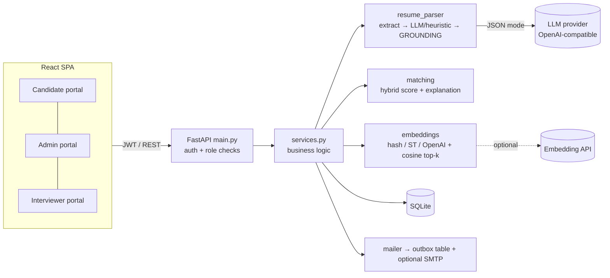

# AI-Powered Recruitment & Interview Management Platform

Candidate portal · Admin recruitment portal · Interview management, with LLM resume parsing, embeddings, hybrid explainable matching and natural-language candidate search.

**Stack:** FastAPI (Python) · SQLite · React (Vite) · any OpenAI-compatible LLM (Groq / OpenAI / Gemini / Ollama) · embeddings (built-in hashing, or sentence-transformers, or an OpenAI-compatible endpoint).

## Honest status (read first)

| Part | Status |
|---|---|
| Core logic (parsing, grounding, dedupe, matching, search, shortlist, approval, interviews, feedback, access control) | ✅ Implemented and **verified by `backend/tests/test_scenarios.py`** (14 tests, all passing) |
| FastAPI HTTP layer (`app/main.py`) | ✍️ Implemented, compiles, thin wrapper over the tested services. **Not run end-to-end in the authoring sandbox** (no network to install FastAPI). Run `scripts/run_api_scenarios.py` after startup to verify it on your machine |
| React frontend | ✍️ Implemented, **not built or run** in the sandbox. Expect to fix small bugs on first `npm run dev` |
| LLM parsing path | ✍️ Implemented; **never exercised against a live provider**. Without an API key the app uses a regex/heuristic parser (tested on the sample resumes) |
| Embeddings | Default `hash` backend is mostly *lexical*. Use `EMBEDDING_BACKEND=st` or `openai` for true semantic similarity |
| Stretch goals | Docker only. No live video, MCP, multi-agent, interview-question generation |

The assessment asks you to explain all submitted code and make a live change. Read `backend/app/` (≈1,000 lines) before the walkthrough.

## Quick start

```bash
# 1. Backend
cd backend
python -m venv .venv && source .venv/bin/activate      # Windows: .venv\Scripts\activate
pip install -r requirements.txt
cp .env.example .env                                   # add LLM_API_KEY to enable LLM parsing
python -m scripts.generate_sample_data                 # (sample data is already included)
python -m scripts.seed                                 # demo users, 3 jobs, 8 sample resumes
uvicorn app.main:app --reload                          # http://localhost:8000/docs  (Swagger)

# 2. Frontend (new terminal)
cd frontend && cp .env.example .env && npm install && npm run dev     # http://localhost:5173

# 3. Verify
cd backend && python -m tests.test_scenarios           # logic tests (no server needed)
python -m scripts.run_api_scenarios                    # 12 scenarios over HTTP (server must be running)
```
Docker: `cp backend/.env.example backend/.env && docker compose up --build`.

**Demo credentials** (created by `scripts.seed`): `admin@demo.com / Admin@12345` · `interviewer@demo.com / Interviewer@12345` · `candidate@demo.com / Candidate@12345`

## Architecture



**Resume flow:** upload → file validated (type/size/magic bytes) → text extracted (pypdf / python-docx) → LLM returns JSON (or heuristic parser) → **grounding** → duplicate check → profile saved → embedding stored → status `Completed` / `Failed`. Each file is its own record and background task, so one bad file never affects others.

## Database / ER diagram

```mermaid
erDiagram
  users ||--o| candidates : "has profile"
  users ||--o{ interviews : "interviews (interviewer)"
  candidates ||--o{ resumes : has
  candidates ||--o{ applications : has
  candidates ||--o{ notes : has
  jobs ||--o{ applications : receives
  jobs ||--o{ share_links : shared_via
  applications ||--o{ interviews : has
  interviews ||--o| feedback : has
  users { int id PK; text email UK; text role "candidate|admin|interviewer"; text password_hash }
  candidates { int id PK; int user_id FK; text skills_json; text experience_json; real total_experience_years; text embedding_json }
  resumes { int id PK; int candidate_id FK; text status "Processing|Completed|Failed"; text error; int duplicate_of FK }
  jobs { int id PK; text title; text required_skills_json; text preferred_skills_json; real min_experience; real max_experience; text status; text embedding_json }
  applications { int id PK; int job_id FK; int candidate_id FK; text status; real score; text detail_json; text override_decision; text override_reason }
  interviews { int id PK; int application_id FK; int interviewer_id FK; text scheduled_at; int duration_min; text status }
  feedback { int id PK; int interview_id FK; int technical; int communication; int problem_solving; text recommendation }
```
Full DDL: `backend/app/db.py`. An `applications` row represents either a candidate's application or an AI match (`status='Matched'`, hidden from candidates until they apply or are shortlisted). `outbox` stores every email sent.

## AI design choices

* **LLM:** any OpenAI-compatible chat endpoint (`LLM_BASE_URL/LLM_MODEL/LLM_API_KEY`) so Groq (free tier, fast), OpenAI, Gemini or local Ollama all work with no code change. Temperature 0, JSON mode, strict schema prompt that forbids inference.
* **Embeddings:** `hash` (default; zero dependencies, offline; hashed TF over canonicalised skill tokens + bigrams), `st` (sentence-transformers `all-MiniLM-L6-v2`; recommended for real semantic matching), `openai` (any `/embeddings` endpoint). Cosine scores are calibrated per backend to 0‑1 because raw cosines differ across models.
* **Vector store:** vectors are stored in SQLite and searched by exact brute-force cosine (numpy). For hundreds–thousands of candidates this is faster and simpler than an ANN index and has no extra service to run. `embeddings.top_k()` is the single seam to swap in pgvector / FAISS / Qdrant at scale.
* **Hallucination handling (`resume_parser.ground`)**: after the LLM answers, every fact is checked against the source text. Names, companies, institutions, projects, skills, emails and phones that don't appear in the resume are dropped and logged in `parse_warnings` (shown to candidate and admin). Experience years are computed in code from dates (overlaps merged), never taken from the LLM. Explanations are generated from computed facts, not free-form LLM text.
* **Human in the loop:** candidates review/edit their parsed profile; admins can correct any field (embedding regenerates), add notes, and override the AI recommendation (reason mandatory; the original AI output is kept alongside).

## Matching methodology (0–100)

| Component | Weight | How |
|---|---|---|
| Required skills | 30 | matched / required (aliases normalised: `k8s`→`kubernetes`, `postgres`→`postgresql`…). Skills count if listed **or evidenced in experience/project text** |
| Preferred skills | 10 | matched / preferred |
| Experience | 20 | 60% total years vs minimum (partial credit below, small penalty far above max) + 40% years in roles that use the job's skills |
| Education | 10 | candidate's highest level (diploma<bachelor<master<PhD) vs requirement; half credit one level below |
| Semantic similarity | 30 | cosine(job embedding, candidate profile embedding), calibrated |

Output per candidate: score, label (Strong ≥75 / Good ≥55 / Partial ≥35 / Weak), matched & missing skills, experience comparison, score breakdown and a plain-language reason. The LLM never produces the score.

**Natural-language search** (`POST /admin/search`): the query is embedded for semantic similarity and also parsed (rule-based) for skills, "N years" and location; the final score blends semantic similarity with skill overlap, with experience/location adjustments, and each hit reports *why* it matched.

**Example output** (sample data, hash embeddings, no LLM): *AI/LLM Engineer* → Rohan Kulkarni 99.6, Vikram Singh 73.8, Aarav Mehta 48.1, Sneha Iyer 37.5, Karan Desai 31.7, Priya Nair 22.0. *Backend Engineer* → Aarav Mehta 95.1, Vikram Singh 63.7, Karan Desai 60.9.

## Security & error handling
PBKDF2-SHA256 password hashing, HS256 JWT with expiry, role-based dependencies on every route, candidates can only read their own profile (403 otherwise), interviewers only see assigned candidates, candidates never see interview feedback, shared shortlist links are random, expiring, read-only and omit contact details, upload type/size/magic-byte validation, parameterised SQL only, no secrets in the repo (`.env` ignored; see `.env.example`). Production notes: put behind HTTPS, rotate `SECRET_KEY`, add rate limiting.

## API documentation
Swagger UI at `/docs`, ReDoc at `/redoc`, OpenAPI JSON at `/openapi.json` (importable into Postman). Route groups: Auth, Candidate, Candidates, Admin (+Resumes/Jobs/Matching/Candidates/Shortlist), Interviews, Shared.

## Mandatory test scenario results

Verified by `python -m tests.test_scenarios` (service layer, real PDF/DOCX files, SQLite, no LLM key). **Run `python -m scripts.run_api_scenarios` against your running server and paste its output here before submitting.**

| # | Scenario | Result | Evidence |
|---|---|---|---|
| 1 | Candidate uploads a resume | ✅ pass | Profile populated: skills, experience, education, years; account email preserved |
| 2 | Admin uploads 5 resumes | ✅ pass | 5 separate records, 5 distinct candidates, all `Completed` (DOCX also OK) |
| 3 | Admin uploads invalid file | ✅ pass | `.txt`, corrupted PDF, empty DOCX → `Failed` with reasons; valid file in same batch `Completed`; duplicate detected (no new profile) |
| 4 | Admin creates a job | ✅ pass | All fields persisted |
| 5 | Select job for matching | ✅ pass | Ranked 0–100; unrelated profiles rank below ML engineer |
| 6 | Natural-language search | ✅ pass | "python developer with LLM and embeddings experience in Pune" → ML/AI profiles first, with reasons |
| 7 | Open candidate profile | ✅ pass | Full profile + matched/missing skills + reason + breakdown |
| 8 | Shortlist | ✅ pass | Job-specific; other job's list untouched; CSV export works |
| 9 | Approve candidate | ✅ pass | Status changed, notification written to `outbox` (SMTP if configured) |
| 10 | Schedule interview | ✅ pass | Saved, visible to candidate, double-booking rejected |
| 11 | Interviewer feedback | ✅ pass | Stored; wrong user rejected; visible in admin feedback list |
| 12 | Access another profile | ✅ pass | `Forbidden` (HTTP 403 via the API) |
| + | Hallucination guard | ✅ pass | Fabricated skill/employer/degree/phone dropped and logged |
| + | Override needs reason | ✅ pass | AI result preserved next to override |
| HTTP | Same scenarios over HTTP | ⏳ **not yet run** | needs your machine (`run_api_scenarios.py`) |

## Known limitations
* Heuristic parser expects conventional headings (Summary/Skills/Experience/Education/Projects) and "Title | Company | Mon YYYY – Present" lines; free-form layouts need the LLM path.
* Skill vocabulary is a curated list (`skills.py`); unusual skills are only found via the LLM (still grounded in the text).
* Education matching compares degree level only, not field of study.
* No email verification/password reset, no refresh tokens, no pagination on large lists.
* SQLite + background tasks suit a demo; use PostgreSQL + a task queue for production.

## Project layout
```
backend/app/        main.py (routes) · services.py (logic) · resume_parser.py · matching.py · embeddings.py · llm.py · skills.py · security.py · db.py · mailer.py
backend/tests/      test_scenarios.py
backend/scripts/    seed.py · generate_sample_data.py · run_api_scenarios.py
frontend/src/       App.jsx (all portals) · api.js · styles.css
sample_data/        8 fictional resumes (PDF/DOCX), invalid files, jobs.json
```
